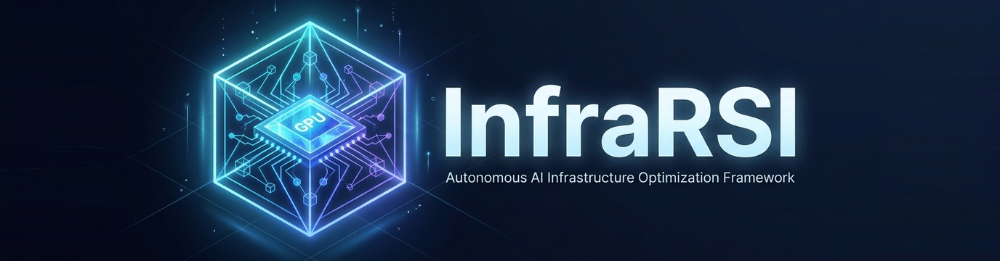
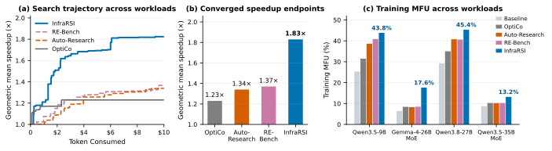

<p align="center">
  <em>Command Once, and Self-Evolve: Your Personal Infra Agent for All Environments.</em>
</p>

<p align="center">
  
</p>

<h3 align="center">
  InfraRSI: Harnessing Recursive Self-Improvement for Training Infrastructure
</h3>

<p align="center">
  <a href="https://arxiv.org/abs/2611.11558"></a>
  <a href="https://infrarsi.github.io/"></a>
  <a href="pyproject.toml"></a>
  <a href="#-getting-started"></a>
  <a href="README_ZH.md"></a>
</p>

<p align="center">
  <b>English</b> | <b><a href="README_ZH.md">简体中文</a></b> | <b><a href="https://arxiv.org/pdf/2611.11558">📄 Paper (PDF)</a></b> | <b><a href="https://infrarsi.github.io/">🌐 Blog, documentation &amp; navigation</a></b>
</p>

InfraRSI improves the training infrastructure around your existing codebase. Give it a working launch script, Python entry point, or repository; it searches for faster configurations and code changes, checks them against your original job, and saves verified experience for future runs.

## 📊 Benchmark Demo

Across four dense and MoE workloads on H100 and H200, the [blog's reported results](https://infrarsi.github.io/#results) show **1.83× geometric-mean speedup**, up to **2.75×**, with mean Model FLOPs Utilization (MFU) rising from **17.4% to 30.0%**. The comparison uses the same task contracts for InfraRSI, RE-Bench, Auto-Research, and OptiCo; failed and audit-excluded attempts still count toward token consumption.

<p align="center">
  <a href="https://infrarsi.github.io/#results"></a>
</p>

| Workload | Hardware | InfraRSI speedup | MFU: baseline → optimized |
| :--- | :--- | ---: | ---: |
| Qwen3.5-9B | 8×H100 | 1.73× | 25.3% → 43.8% |
| Gemma-4-26B-A4B MoE | 8×H200 | 2.75× | 6.4% → 17.6% |
| Qwen3.8-27B | 8×H200 | 1.55× | 29.3% → 45.4% |
| Qwen3.5-35B-A3B MoE | 16×H100, 2 nodes | 1.51× | 8.7% → 13.2% |
| **Geomean speedup / mean MFU** | | **1.83×** | **17.4% → 30.0%** |

The figure is reused from the blog. See [full results and per-workload trajectories](https://infrarsi.github.io/#results) for the comparisons and measurement details.

## ✨ Features

- 🚀 **Optimize parameters and code together.** B-Comp searches launch flags, environment variables, configuration keys, and allowed code patches—combining memory savings with faster kernels, compilation, and communication settings.
- 🧩 **Use your stack and model service.** Supports Megatron-Core, FSDP2/TorchTitan, DeepSpeed, HF Trainer/TRL, and native PyTorch DDP, on one or multiple nodes. Choose Claude Code, Codex, DeepSeek, Anthropic/OpenAI APIs, an OpenAI-compatible endpoint, or self-hosted vLLM.
- 🔁 **Carry experience to the next job.** Verified results become reusable experience. In the blog's cross-hardware study, experience from other GPU types improved Qwen3.5-9B on 8×H100 from **1.70× to 1.82×**, reaching 90% of the peak log-speedup in 9 trials.
- ✨ **Start with one command.** `infrarsi optimize ./train.sh` handles `init → doctor → run → report → apply` and writes `infrarsi_optimized.sh` for the verified result.
- 🛡️ **Check before adopting.** The harness checks workload, data, optimizer steps, and numerical tolerance, then tests the winner in fresh re-runs. Add natural-language requirements or optional second-model review; the report identifies checks your project does not yet support.

See the [blog highlights](https://infrarsi.github.io/#highlights) for examples and the [verification guide](https://infrarsi.github.io/#verification) for the checks.

## ⚡ Getting Started

### 1. Install

Requires Python 3.10+.

```bash
git clone https://github.com/TokenRhythm/InfraRSI.git
cd InfraRSI
pip install -e .
infrarsi --version
```

### 2. Use the LLM you already have

⚠️ **Start with a codebase or launch command that already runs successfully.** Run the original job once, then choose one of these four paths. Replace `./train.sh` with your project's launch script.

| Path | Setup | InfraRSI backend |
| :--- | :--- | :--- |
| Claude Code | Installed and signed in | `claude-cli` |
| Codex | Installed and signed in | `codex-cli` |
| DeepSeek API | `DEEPSEEK_API_KEY` | `deepseek:deepseek-chat` |
| OpenAI-compatible API / gateway | Provider key and endpoint | `openai-compat:MODEL` |

```bash
# Claude Code
infrarsi optimize ./train.sh --llm claude-cli --screens 16

# Codex, with an optional token cap
infrarsi optimize ./train.sh --llm codex-cli --screens 16 --token-budget 500k

# DeepSeek, with an optional API spend cap
export DEEPSEEK_API_KEY="your-key"
infrarsi optimize ./train.sh --llm deepseek:deepseek-chat --screens 16 --budget-usd 10

# OpenAI-compatible endpoint (OpenRouter example)
export OPENROUTER_API_KEY="your-key"
infrarsi optimize ./train.sh --llm openai-compat:anthropic/claude-sonnet-4 --api-base https://openrouter.ai/api/v1 --api-key-env OPENROUTER_API_KEY
```

`infrarsi ./train.sh` is shorthand for `infrarsi optimize ./train.sh`. Python entries and repository paths work too. The [blog quick start](https://infrarsi.github.io/#quickstart) includes SiliconFlow, self-hosted vLLM, and manifest examples.

### 3. Inspect or run each stage separately

From your training repository:

```bash
infrarsi init
infrarsi doctor
infrarsi run --strategy bcomp --llm codex-cli
infrarsi report
infrarsi apply --write
```

See the [five-stage workflow](https://infrarsi.github.io/#workflow) and [CLI reference](https://infrarsi.github.io/#cli) for details.

### 4. Or let a Claude Code / Codex session drive it

Install the `infrarsi-optimize` skill, open a session in your training repository and ask it to make the job faster:

```bash
python agent_skill/install_skill.py
```

The session adapts the project and talks to you; the same engine runs, checks and reports; each question the search asks is answered by a fresh sub-agent of the session's own model, so no API key is needed. See [agent_skill/README.md](agent_skill/README.md).

## 🧭 Before and During a Run

- **Checklist:** Review six settings; **Enter starts**, a number edits, `more` opens advanced options, and `q` quits. `--yes` skips prompts and disables live chat.
- **Requirements:** Use `--requirements "do not change the optimizer"`. Add `--second-llm claude-cli` for optional second-model review; it is off by default.
- **Budget:** New projects default to **16 full runs**. Time, token, GPU-hour, and dollar caps are optional; existing limits remain in force. Baseline checks, diagnosis, and final verification are separate from the search budget. See [targets and budgets](https://infrarsi.github.io/#stopping).
- **Launch fails:** Choose `r` to retry, `m` to edit the command, or `d` for model diagnosis. Diagnosis shows a separate allowance; a proposed command needs your confirmation before retrying.
- **Live chat:** On a POSIX terminal, **Ctrl-G** opens the panel. Use `/status`, `/pause`, `/resume`, `/stop`, or `/note your guidance`. Replies and control changes wait for trial boundaries; confirmation pairs finish together. Chat uses the search budget, and paused time still counts.
- **Stop:** Ctrl-C stops search and re-verifies the best result; a second Ctrl-C exits immediately. After a killed or disconnected run, `infrarsi finish RUN_DIR` can complete verification.

💾 **Resume B-Comp (`bcomp`)** from the project directory:

```bash
infrarsi run --resume latest --screens 32
```

You can replace `latest` with a run directory; for a custom output root, add `--out /path/to/runs`. Budgets are totals **including work already done**, so raise any exhausted caps. This resumes the optimization search, not the training job's own checkpoint.

## 📝 Citation

If InfraRSI supports your work, please cite our [paper](https://arxiv.org/abs/2611.11558) ([PDF](https://arxiv.org/pdf/2611.11558)):

```bibtex
@misc{infrarsiteam2026infrarsiharnessingrecursiveselfimprovement,
      title={InfraRSI: Harnessing Recursive Self-Improvement for Training Infrastructure},
      author={{InfraRSI Team} and Yuchuan Tian and Haocheng Mei and Ye Yuan and Chao Xu and Boxun Li and Guohao Dai and Kai Han and Allen Chen and Yunhe Wang and Yu Wang},
      year={2026},
      eprint={2611.11558},
      archivePrefix={arXiv},
      primaryClass={cs.AI},
      url={https://arxiv.org/abs/2611.11558},
}
```

📖 The full navigation, usage guide, and experiment write-up are on the [**InfraRSI blog**](https://infrarsi.github.io/).
