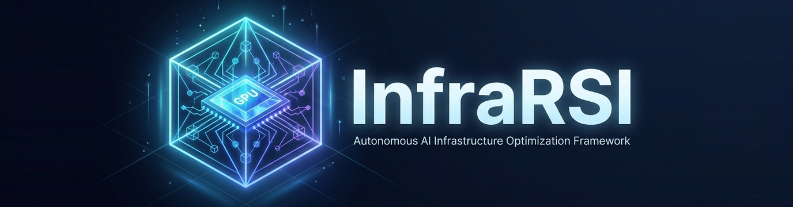
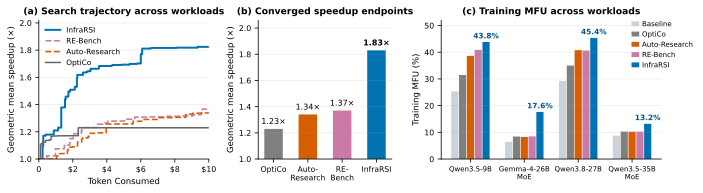

<p align="center">
  <em>Command Once, and Self-Evolve: Your Personal Infra Agent for All Environments.</em>
</p>

<p align="center">
  
</p>

<h3 align="center">
  InfraRSI：用递归自我改进优化大模型训练基础设施
</h3>

<p align="center">
  <a href="https://arxiv.org/abs/2611.11558"></a>
  <a href="https://infrarsi.github.io/?lang=zh"></a>
  <a href="pyproject.toml"></a>
  <a href="#-快速上手-getting-started"></a>
  <a href="README.md"></a>
</p>

<p align="center">
  <b><a href="README.md">English</a></b> | <b>简体中文</b> | <b><a href="https://arxiv.org/pdf/2611.11558">📄 论文 (PDF)</a></b> | <b><a href="https://infrarsi.github.io/?lang=zh">🌐 博客、文档与完整导航</a></b>
</p>

InfraRSI 面向既有代码库优化训练基础设施。交给它一个已跑通的启动脚本、Python 入口或代码仓，它会搜索更快的配置与代码改动，与原始任务对比验证，并把验证过的经验留给后续任务。

## 📊 实验演示 (Benchmark Demo)

与 [blog 的实验结果](https://infrarsi.github.io/?lang=zh#results)保持一致：在 H100、H200 上的四个稠密与 MoE 训练负载中，InfraRSI 实现 **1.83× 几何平均加速**、最高 **2.75×**，平均模型算力利用率（MFU）从 **17.4% 提升至 30.0%**。InfraRSI、RE-Bench、Auto-Research 和 OptiCo 使用相同任务约定；失败及审查剔除的候选消耗同样计入 Token 横轴。

<p align="center">
  <a href="https://infrarsi.github.io/?lang=zh#results"></a>
</p>

| 训练负载 | 硬件 | InfraRSI 加速比 | MFU：基线 → 优化后 |
| :--- | :--- | ---: | ---: |
| Qwen3.5-9B | 8×H100 | 1.73× | 25.3% → 43.8% |
| Gemma-4-26B-A4B MoE | 8×H200 | 2.75× | 6.4% → 17.6% |
| Qwen3.8-27B | 8×H200 | 1.55× | 29.3% → 45.4% |
| Qwen3.5-35B-A3B MoE | 16×H100，双节点 | 1.51× | 8.7% → 13.2% |
| **几何平均加速 / 平均 MFU** | | **1.83×** | **17.4% → 30.0%** |

图表直接复用 blog。完整对比、逐任务搜索曲线与测量说明见[实验结果](https://infrarsi.github.io/?lang=zh#results)。

## ✨ 核心亮点 (Features)

- 🚀 **参数与代码一起优化。** B-Comp 联合搜索启动参数、环境变量、配置项与允许修改的代码，把省显存方案与更快的算子、编译和通信设置组合起来。
- 🧩 **适配已有技术栈和模型服务。** 支持 Megatron-Core、FSDP2/TorchTitan、DeepSpeed、HF Trainer/TRL、原生 PyTorch DDP，以及单机和多机。可用 Claude Code、Codex、DeepSeek、Anthropic/OpenAI API、OpenAI 兼容接口或自建 vLLM。
- 🔁 **经验随任务积累，跨硬件复用。** 验证过的结果会成为后续任务的经验。blog 的跨硬件实验中，其他 GPU 型号的经验让 Qwen3.5-9B 在 8×H100 上从 **1.70× 提升至 1.82×**，第 9 次试验即达到 90% 的峰值对数加速。
- ✨ **一条命令开始。** `infrarsi optimize ./train.sh` 完成 `init → doctor → run → report → apply`，为验证通过的结果生成 `infrarsi_optimized.sh`。
- 🛡️ **先验证，再采用。** 检查训练负载、数据、优化器步数和数值容差，胜出方案还需通过独立复测。支持自然语言约束和可选的第二模型审查；项目尚不支持的检查会在报告中标明。

更多例子见 [blog 核心亮点](https://infrarsi.github.io/?lang=zh#highlights)，检查规则见[正确性验证](https://infrarsi.github.io/?lang=zh#verification)。

## ⚡ 快速上手 (Getting Started)

### 1. 安装

需要 Python 3.10+。

```bash
git clone https://github.com/TokenRhythm/InfraRSI.git
cd InfraRSI
pip install -e .
infrarsi --version
```

### 2. 直接用你手头的大模型

⚠️ **建议提供已经能正常运行的 codebase 或启动命令，先独立跑通原始任务。** 下面四条接入路径任选其一，将 `./train.sh` 换成你的项目启动脚本。

| 接入方式 | 准备工作 | InfraRSI 后端 |
| :--- | :--- | :--- |
| Claude Code | 本机已安装并登录 | `claude-cli` |
| Codex | 本机已安装并登录 | `codex-cli` |
| DeepSeek API | 设置 `DEEPSEEK_API_KEY` | `deepseek:deepseek-chat` |
| OpenAI 兼容 API / 网关 | 服务商 Key 与接口地址 | `openai-compat:MODEL` |

```bash
# Claude Code
infrarsi optimize ./train.sh --llm claude-cli --screens 16

# Codex，可选设置 Token 上限
infrarsi optimize ./train.sh --llm codex-cli --screens 16 --token-budget 500k

# DeepSeek，可选设置 API 费用上限
export DEEPSEEK_API_KEY="your-key"
infrarsi optimize ./train.sh --llm deepseek:deepseek-chat --screens 16 --budget-usd 10

# OpenAI 兼容接口（以 OpenRouter 为例）
export OPENROUTER_API_KEY="your-key"
infrarsi optimize ./train.sh --llm openai-compat:anthropic/claude-sonnet-4 --api-base https://openrouter.ai/api/v1 --api-key-env OPENROUTER_API_KEY
```

`infrarsi ./train.sh` 是 `infrarsi optimize ./train.sh` 的简写，也可以传入 Python 入口或仓库目录。硅基流动、自建 vLLM 与 manifest 示例见 [blog 快速上手](https://infrarsi.github.io/?lang=zh#quickstart)。

### 3. 查看结果或分步运行

在你的训练项目目录执行：

```bash
infrarsi init
infrarsi doctor
infrarsi run --strategy bcomp --llm codex-cli
infrarsi report
infrarsi apply --write
```

各阶段说明见[五步工作流程](https://infrarsi.github.io/?lang=zh#workflow)，完整参数见 [CLI 文档](https://infrarsi.github.io/?lang=zh#cli)。

## 🧭 运行前后与运行中

- **启动清单：** 默认六项，**回车开始**，输入编号修改，`more` 展开高级选项，`q` 退出。`--yes` 跳过提问并禁用实时对话。
- **约束与审查：** 用 `--requirements "不能改优化器"` 提出需求；需要第二模型审查时加 `--second-llm claude-cli`，默认关闭。
- **预算：** 新项目默认 **16 次完整试跑**；时间、Token、GPU 小时和费用上限可选，已有设置仍生效。基线检查、诊断与最终复验不计入搜索预算。更多用法见[目标与预算](https://infrarsi.github.io/?lang=zh#stopping)。
- **启动失败：** `r` 重试、`m` 修改命令、`d` 请模型诊断。诊断会显示独立额度，提出的命令须经你确认后才重试。
- **实时对话：** POSIX 终端按 **Ctrl-G**，支持 `/status`、`/pause`、`/resume`、`/stop` 和 `/note 你的建议`。回复与控制在试跑边界处理，成对确认测量会先完成；对话计入搜索预算，暂停期间时间仍计入预算。
- **停止与收尾：** Ctrl-C 停止搜索并复验最佳结果，再按一次直接退出。进程被杀或断连后，可用 `infrarsi finish RUN_DIR` 完成复验。

💾 **B-Comp（`bcomp`）断点续跑**，在项目目录执行：

```bash
infrarsi run --resume latest --screens 32
```

也可将 `latest` 换成运行目录；自定义输出根目录时加 `--out /path/to/runs`。预算是**包含已消耗部分的总量**，已耗尽的限制需要提高。这里恢复的是优化搜索，训练任务自身的 checkpoint 另行管理。

## 📝 引用说明 (Citation)

如果 InfraRSI 对你的工作有帮助，请引用我们的[论文](https://arxiv.org/abs/2611.11558)（[PDF](https://arxiv.org/pdf/2611.11558)）：

```bibtex
@misc{infrarsiteam2026infrarsiharnessingrecursiveselfimprovement,
      title={InfraRSI: Harnessing Recursive Self-Improvement for Training Infrastructure},
      author={{InfraRSI Team} and Yuchuan Tian and Haocheng Mei and Ye Yuan and Chao Xu and Boxun Li and Guohao Dai and Kai Han and Allen Chen and Yunhe Wang and Yu Wang},
      year={2026},
      eprint={2611.11558},
      archivePrefix={arXiv},
      primaryClass={cs.AI},
      url={https://arxiv.org/abs/2611.11558},
}
```

📖 完整导航、使用指南和实验介绍请直接访问 [**InfraRSI blog**](https://infrarsi.github.io/?lang=zh)。
